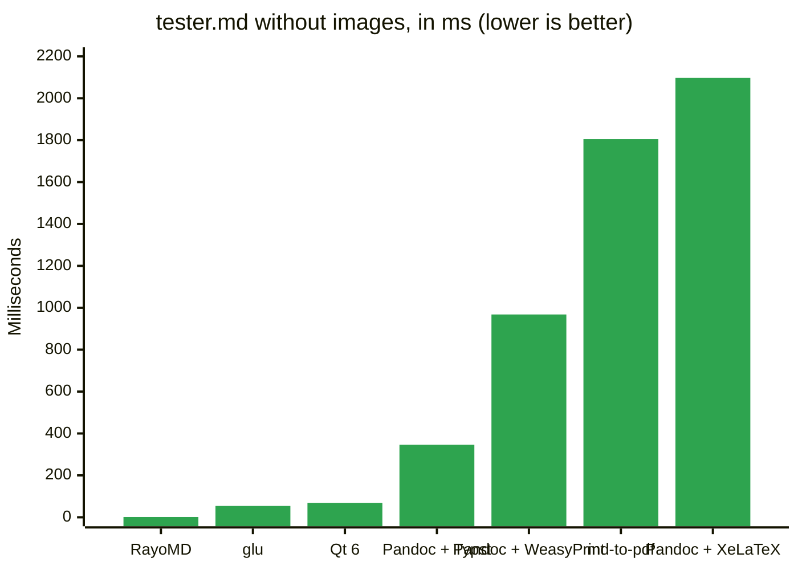

<a id="readme-top"></a>

<div align="center">


# RayoMD

**Markdown to PDF in milliseconds, from a single small executable.**<br>
No browser. No LaTeX. No Pandoc. No runtime.

<a href="https://github.com/Butterski/rayomd/releases/latest"></a>
<a href="https://github.com/Butterski/rayomd/releases"></a>
<a href="LICENSE"></a>

<a href="https://github.com/Butterski/rayomd/actions/workflows/ci.yml"></a>
<a href="https://github.com/Butterski/rayomd/actions/workflows/hygiene.yml"></a>
<a href="https://github.com/Butterski/rayomd/actions/workflows/release.yml"></a>
<a href="https://github.com/Butterski/rayomd/actions/workflows/codeql.yml"></a>
<a href="https://github.com/Butterski/rayomd/actions/workflows/fuzz.yml"></a>


<a href="https://github.com/Butterski/rayomd/stargazers"></a>

[**Download**](https://github.com/Butterski/rayomd/releases/latest) ·
[Quick start](#quick-start) ·
[Features](#features) ·
[Benchmarks](#performance) ·
[Documentation](https://github.com/Butterski/rayomd/wiki)

</div>

> [!TIP]
> **New in 5.0:** `rayomd.exe` is the command-line tool alone (the desktop app is RayoMD GUI), and
> untrusted documents are safer to export: link targets are checked as a PDF viewer reads them, a
> book's files stay in its folder, hostile runs of headings, tables, references and SVG gradients
> take linear time, and the static Linux build loads at a random address. Embedders get
> `PdfOptions::cancel` and `PdfOptions::sourceMap`; ordinary documents keep their PDF bytes.

RayoMD parses Markdown and writes PDF bytes directly, in its own C++17 code: a small
command-line tool for Linux and Windows, and an exporter you can embed through the
[C++ API](https://github.com/Butterski/rayomd/wiki/C++-API). The desktop app for Linux and
Windows is developed in a separate repository, RayoMD GUI.

## Highlights

<table>
<tr>
<td width="33%" valign="top">

### Fast
A short note in under **1 ms**, start to exit; a 1024×1024 PNG in 8 to 11 ms, 2 ms once
converted. Batches run on up to 64 threads.

</td>
<td width="33%" valign="top">

### Small
A **790 KB** Linux download and a 1.6 MB Windows download. No browser engine, TeX stack or
runtime to install.

</td>
<td width="33%" valign="top">

### Math
A TeX subset **typeset natively**: fractions, roots, sums, matrices, in embedded fonts. No
LaTeX.

</td>
</tr>
<tr>
<td valign="top">

### Code and images
Code coloured as on GitHub in **29 languages**; PNG, JPEG, and SVG drawn as vectors.

</td>
<td valign="top">

### Books and themes
One PDF from a `SUMMARY.md`, tables of contents, company fonts, colours, headers and a
cover.

</td>
<td valign="top">

### Standards
Tagged **PDF/UA-1** for screen readers and **PDF/A-3b** for archives, validated with
veraPDF.

</td>
</tr>
</table>

## Quick start

<details open>
<summary><b>Linux</b>: download and run</summary>

```sh
curl -LO https://github.com/Butterski/rayomd/releases/download/v5.0.0/rayomd-5.0.0-linux-x64-static.tar.gz
tar -xzf rayomd-5.0.0-linux-x64-static.tar.gz
./rayomd-5.0.0-linux-x64-static/rayomd --export input.md output.pdf
```

</details>

<details>
<summary><b>Windows</b>: the command-line tool, <code>rayomd.exe</code></summary>

Download `rayomd-5.0.0-windows-x64.zip` from
[Releases](https://github.com/Butterski/rayomd/releases/latest) and unpack it. `rayomd.exe`
is the same CLI as on Linux:

```sh
rayomd.exe --export input.md output.pdf
```

Since 5.0.0, `rayomd.exe` started without arguments prints its usage; up to 4.7.0 it opened a
desktop app, which RayoMD GUI replaces.

</details>

<details>
<summary><b>Build from source</b></summary>

A C and C++17 compiler and CMake; on Linux also a TrueType or OpenType font such as
`fonts-dejavu-core`. On Windows add `-G "MinGW Makefiles"`.

```sh
cmake -S . -B build -DCMAKE_BUILD_TYPE=Release
cmake --build build --config Release
./build/rayomd --doctor
./build/rayomd --export input.md output.pdf
```

</details>

| Package | Size, 4.7.0 | For |
|---|---:|---|
| `rayomd-<version>-linux-x64-static.tar.gz` | 1,187 KB | Linux, recommended: no dependency, the fastest start |
| `rayomd-<version>-windows-x64.zip` | 1,598 KB | Windows: every CLI mode in one `rayomd.exe` |
| `rayomd-<version>-linux-x64.tar.gz` | 787 KB | Linux: needs only glibc |
| `rayomd-<version>-linux-x64-curl.tar.gz` | 789 KB | Linux with HTTP/HTTPS images through libcurl |

Every feature below works the same from both command lines and the
[C++ API](https://github.com/Butterski/rayomd/wiki/C++-API).

## Performance

Measured on an AMD Ryzen 5 PRO 4650GE in an Arch Linux container without network: RayoMD on
2026-10-14, the other tools on 2026-10-13. A one-shot export is a fresh process, start to exit.

### Against other tools

Each tool converts the repository's `tester.md` (headings, Unicode text, code, tables, lists,
quotes, footnotes and formulas) as a fresh process, median of 20 on four pinned cores.



| Tool | Version | Without images | With a 1024×1024 PNG | Peak memory | Installed size¹ | Formulas |
|---|---|---:|---:|---:|---:|---|
| **RayoMD** | 4.6.0 | **1.4 ms** | **7.6 ms** | **3.6 MiB** | **1.4 MiB** | typeset |
| glu | 0.0.46 | 54 ms (40×) | 85 ms (11×) | 33 MiB | 25 MiB | TeX source |
| Qt 6 `QTextDocument` + `QPrinter` | 6.12.0 | 69 ms (51×) | 112 ms (15×) | 39 MiB | 373 MiB | TeX source |
| Pandoc + Typst | 3.11, Typst 0.15.1 | 346 ms (252×) | 376 ms (49×) | 239 MiB² | 0.65 GiB | typeset |
| Pandoc + WeasyPrint | 3.11, WeasyPrint 70.0 | 968 ms (706×) | 1,238 ms (162×) | 241 MiB² | 0.9 GiB | MathML text and TeX |
| md-to-pdf | 5.2.5, Chromium 154 | 1,805 ms (1,317×) | 1,903 ms (249×) | 205 MiB² | 1.0 GiB | TeX source |
| Pandoc + XeLaTeX | 3.11, TeX Live 2026 | 2,097 ms (1,530×) | 3,351 ms (439×) | 340 MiB² | 1.4 GiB | typeset |

¹ Approximate: the tool's packages and their dependencies beyond a base Arch Linux image. Qt
comes with any Qt desktop. ² The largest single process; these tools run several.

On one core RayoMD takes 1.39 ms (11.2 ms with the PNG, which it re-encodes on up to four cores)
and the others 64 ms to 2.2 s. In a running process (`--serve`, `--batch`, `--bench`) each
further export takes **0.23 ms**.

> [!NOTE]
> The documents are `tester.md` without the five lines that test fallbacks: the remote and
> missing images and a formula with an unknown TeX command. RayoMD shows those as fallback text;
> with them XeLaTeX and glu stop with an error, and Pandoc waits on the network. The imageless one
> also drops the mascot PNG. RayoMD converts the PNG every run (`--no-image-cache`), as the
> others do. Pandoc reads `markdown+tex_math_single_backslash-raw_tex`. Qt prints through a small
> harness with an 11 pt font. The tools render different Markdown subsets and look different, so
> this compares time to a finished PDF, not identical output. Method, one-core figures, page
> renders and each tool's output:
> [comparison of 2026-10-13](https://github.com/Butterski/rayomd/wiki/Markdown-to-PDF-Comparison-2026-10-13).

### Release by release

The big steps only: 4.0 rewrote the text path in lower-level code and linked the C++ runtime in;
4.1 and 4.2 replaced zlib with RayoMD's own PNG decoder and encoder, a row at a time and on up
to four cores; 4.3 writes Unicode text in two bytes a character; 4.4 cuts what a fresh process
costs around the export (page faults, `libm.so`, the output write) and the work per word and
per allocation in the export itself. 4.5 and 4.6 add work instead: formulas embed their fonts
(`tester.md`'s PDF grows from 75 to 86 KB) and HTML is read, 1 to 9 % on these documents.
One-shot export onto an existing PDF, one pinned core, median of 40, the four releases measured
in one session:

| Document | 3.2.0 | 4.0.0 | 4.4.0 | 4.6.0 |
|---|---:|---:|---:|---:|
| Short note, ASCII | 1.67 ms | 0.87 ms | 0.75 ms | **0.76 ms** |
| Short note, Polish | 2.68 ms | 1.20 ms | 0.83 ms | **0.86 ms** |
| Essay, 10,000 words | 2.37 ms | 1.54 ms | 1.27 ms | **1.29 ms** |
| `tester.md`, no images | 3.12 ms | 1.65 ms | 1.22 ms | **1.33 ms** |
| README of 4.3.1 (Unicode text) | 3.75 ms, 270 KB | 2.26 ms, 270 KB | 1.65 ms, 221 KB | **1.77 ms**, 216 KB |
| One 1024×1024 RGBA PNG | 90.7 ms | 28.9 ms | 10.6 ms | **10.7 ms** |

The README row leaves out the README's two images: 4.6.0 draws them as GitHub shows them (15.4 ms
with both converted, 3.1 ms from the image cache), where earlier releases printed the HTML as text.

From 32,768 pixels a converted image is kept in the user cache directory, so its next export, in
any process, takes about 2 ms; `--no-image-cache` turns that off. Text and pixels are the same
from 3.2.0 to 4.4.0; 4.5.0 draws bullets as markers and formulas in embedded fonts, and 4.6.0
renders HTML. The fully static Linux edition starts another 0.2 to 0.3 ms sooner.

Every change is profiled on a real export, rewritten, and kept only if a pinned A/B shows it
faster and the PDF bytes (for a re-encoded image, the pixels) stay the same, unless changing
them is its purpose.
[`performance.md`](docs/development/performance.md) says how the numbers are taken and lists
what is left in the profiles and what was tried and rejected; what each change gained is in the
wiki's [Performance History](https://github.com/Butterski/rayomd/wiki/Performance-History), and
older reports are in the [benchmark index](https://github.com/Butterski/rayomd/wiki/Benchmarks).

<p align="right"><a href="#readme-top">back to top ↑</a></p>

## Features

### Markdown

GitHub-flavoured Markdown as people write it. Headings become PDF bookmarks and `#anchor`
targets, bullets are drawn as a browser draws them (a disc, a circle one level in, then
squares), and a table's header row repeats on every page it reaches:

```markdown
# Report

Text with **bold**, *italic*, ~~strike~~, `code` and a [link](https://example.com).
A bare URL like https://example.com and an address like team@example.com are clickable.

- [x] Task lists
- Nested bullet and numbered lists
  1. like this one

> [!WARNING]
> GitHub alerts: NOTE, TIP, IMPORTANT, WARNING and CAUTION.

| Item | Price |
|:-----|------:|
| Tea  |  2.50 |

A sentence with a footnote.[^1]

[^1]: Set after the text, linked both ways.
```

Also reference links (full, collapsed and shortcut), `<…>` autolinks, rules, page breaks
(`\pagebreak`, `\newpage`, `<!-- pagebreak -->`), `<br>`, character references such as
`&copy;`, and hidden HTML comments. A link to a `javascript:`, `vbscript:`, `data:` or `file:`
URL, a drive path (`C:\…`) or a network share (`\\host\share`) keeps its text but is not made
clickable, in Markdown as in HTML. Unicode text uses an embedded subset of a system font (or
the one `RAYOMD_FONT` names, TrueType or OpenType: `.ttf`, `.otf`, `.ttc`) with fallback fonts
for other scripts, Noto Sans CJK first for Chinese, Japanese and Korean; Latin text stays on the
PDF standard fonts, which keeps those files small.

### HTML in Markdown

Inline HTML as GitHub shows it: `<b>`, `<i>`, `<s>`, `<code>`, `<kbd>`, `<u>`, `<mark>`, `<sup>`
and `<sub>`, `<a href>`, `<q>`, `<br>`, and `` as its alt text. Other tags are removed and
their text kept; `<script>`, `<style>` and the like are left out with their content, and links
follow the same URL rules as Markdown links.

HTML blocks become what they stand for: `align="center"` or `"right"` and `<center>` place the
text, headings and images inside (also Markdown between an opening and a closing `<div>`),
`` sizes an image, a paragraph of images shows them side by side, a block
element's `id`, `<a id>` or `<a name>` is a `#link` target, and `<details>`/`<summary>`, `<pre>`,
`<blockquote>`, lists, tables and `<dl>` become their Markdown counterparts. Markdown inside an
HTML block shows as written, as on GitHub.

```markdown
<div align="center">
  <a id="top"></a>
   

# A centred title

Press <kbd>Ctrl</kbd>+<kbd>C</kbd>, then <mark>paste</mark>: H<sub>2</sub>O, E = mc<sup>2</sup>.
</div>

<p align="right"><a href="#top">back to top</a></p>
```

### Code highlighting

Fenced code in one of 29 languages is coloured as GitHub's light theme colours it: shell,
console, PowerShell, batch, JavaScript, TypeScript, Python, C, C++, C#, Java, Kotlin, Go, Rust,
Swift, PHP, Ruby, SQL, HTML, XML, CSS, SCSS, JSON, YAML, TOML, INI, Dockerfile and diff.
`--no-highlight` draws every block in one colour.

````markdown
```python
def greet(name):
    return f"Hello, {name}"
```
````

### Math

A TeX subset typeset natively, with no LaTeX, in text, lists, quotes, headings and table cells,
also in PDF/A. The formula fonts are built in (TeX Gyre Termes outlines) and embedded with the
glyphs a document uses, so formulas look the same in every viewer. Unknown or malformed input
degrades to readable output; see [`native_math.md`](docs/development/native_math.md).

```markdown
The roots are $x = \frac{-b \pm \sqrt{b^2 - 4ac}}{2a}$.

$$
\sum_{i=1}^{n} i = \frac{n(n+1)}{2}
$$
```

### Images

```markdown


```

- PNG and JPEG, sized to the page; a missing or unreadable image shows its alt text, and an
  image inside a paragraph reads `image: alt`.
- A PNG with transparency is re-encoded once: from 32,768 pixels on it is kept in the user
  cache directory (`~/.cache/rayomd/images`, on Windows `%LOCALAPPDATA%\RayoMD\cache\images`;
  at most about 256 MB), so later exports of the same image skip the work. The PDF is the same
  either way; `--no-image-cache` keeps nothing.
- `--fast-images` re-encodes such a PNG faster, for image streams a few percent larger (the
  pixels are the same): a 1024x1024 one about 1 ms sooner on one CPU.

  ```sh
  rayomd --export report.md report.pdf --fast-images
  ```
- SVG drawn as vectors by RayoMD's own converter: paths, shapes, transforms, clipping, linear
  gradients, opacity, text in the document's font, embedded PNG/JPEG, and Illustrator style
  sheets. Charts from matplotlib, Vega-Lite, Plotly and Graphviz draw close to a browser; an SVG
  that needs scripts or HTML (Mermaid) shows its alt text.
- Local images must lie in the input file's folder unless `--allow-unsafe-local-images`;
  HTTP/HTTPS images load only with `--allow-url-images` (Windows, and the curl Linux build).

### Page layout

Styles `elegant` (default), `modern` and `tech`; margins `compact`, `normal`, `wide`,
`margin=0.75in` or `margin=54pt`; page sizes `a4` (default), `a3`, `a5`, `letter`, `legal`,
each also `-landscape`, or any `WIDTHxHEIGHT` in `mm`, `cm`, `in` or `pt`; "N / M" page
numbers. A new page starts at `\pagebreak`, `\newpage` or `<!-- pagebreak -->`, at the HTML
page breaks other tools are given (`<div style="page-break-after: always"></div>`,
`break-before: page`, `class="page-break"`), and with `--page-break-before=h1` before each
chapter heading (`h2`: and each section).

```sh
rayomd --export report.md report.pdf modern wide --page-size=letter-landscape --page-numbers
rayomd --export notes.md notes.pdf --page-break-before=h1
```

### Document metadata

The YAML front matter fills the PDF's metadata and is not shown on the page. Without a `title`
the first heading is the title; `description` stands in for `subject`.

```yaml
---
title: Quarterly report
author: [Ann Smith, Bob Lee]
subject: Sales in Q3
keywords: [sales, q3]
lang: en-GB
---
```

### Tables of contents

A paragraph `[TOC]` or `[[_TOC_]]` becomes a table of contents with dot leaders, page numbers
and links to the headings; `--toc` puts one first, and `--toc-depth=N` (1 to 6, default 3) sets
how many heading levels it lists. `--number-headings` numbers the headings 1, 1.1, 1.1.1 (to
`--number-headings=N` levels, default 3) in the text, the table of contents and the bookmarks;
a document's title heading stays unnumbered, and `#links` keep working.

```sh
rayomd --export handbook.md handbook.pdf --toc --toc-depth=2 --number-headings
```

### Themes

`--theme=FILE` lays a company look over a style: your TrueType or OpenType font with its bold,
italic and bold italic faces (each optional; headings, bold text and table headers in the bold
one), heading, link and accent colours, a header and footer with placeholders (`{title}`,
`{author}`, `{subject}`, `{date}`, `{page}`, `{pages}`, `{logo}`) and a logo, and a cover page.
Paths are relative to the theme file, and theme fonts and logos are local files: on Windows,
network (UNC, WebDAV, mapped network drive) and device paths are refused. See
[Themes](https://github.com/Butterski/rayomd/wiki/Themes).

<details>
<summary>Example theme file</summary>

```ini
font = fonts/AcmeSans-Regular.ttf
font-bold = fonts/AcmeSans-Bold.ttf
font-italic = fonts/AcmeSans-Italic.ttf
font-bold-italic = fonts/AcmeSans-BoldItalic.ttf
heading-color = #0B3D91
link-color = #0B6E4F
accent-color = #F2A900
header-left = {logo}
header-right = {title}
footer-left = {author}
footer-right = {date}
logo = acme-logo.svg
cover = yes
```

</details>

### Books

`--book` makes one PDF of several files: those a `SUMMARY.md` lists (mdBook and GitBook, with
parts and nesting), a folder's files by name with `README.md` first, or the files given. Each
starts on a new page, links between them (`other.md#heading`) stay links inside the PDF, the
bookmarks nest by part, and `--toc` gives one table of contents for the whole book. A book's
files may total 128 MiB, as much as one document, and a `SUMMARY.md` lists each file once
(another name for it, such as a link, counts as the same file). The files a `SUMMARY.md` lists
or a book folder holds must lie in that folder, also once links and `..` are resolved, so a
book from elsewhere cannot put your other files into its PDF.

```sh
rayomd --book docs/src/SUMMARY.md manual.pdf --toc --page-numbers
```

### Batch conversion

`--batch` converts a folder on up to 64 threads (6 by default); `--recursive` mirrors its
subfolders, `--skip-unchanged` keeps PDFs newer than their Markdown, and `--report` writes one
JSON line per document (`-` for standard output). `--stdin` converts Markdown piped in,
`--stdin-batch` converts the paths piped in, and `--serve` stays running and converts each path
it reads, answering one line per document.

```sh
rayomd --batch docs pdf-out --recursive --skip-unchanged --report=report.jsonl --workers=8
cat notes.md | rayomd --stdin notes.pdf
```

### Compression, archiving and accessibility

- `--compress` writes page content, fonts and CMaps as FlateDecode streams with RayoMD's own
  DEFLATE encoder: text-heavy PDFs come out two to five times smaller.
- `--pdfa` writes PDF/A-3b for archiving: every font embedded (the formula fonts too), an sRGB
  output intent, XMP metadata and a file identifier.
- `--pdfua` writes tagged PDF/UA-1 for screen readers: headings, lists, tables with header
  scope, figures with their alt text, formulas, links and footnotes in reading order, decoration
  marked as artifacts; the language is the front matter's `lang`, else `en`.

PDF/A and PDF/UA need a TrueType or OpenType font to embed; PDF/UA shows formulas as their TeX
source. Together the file claims both, and every test document passes veraPDF. See
[Archival and Accessible PDFs](https://github.com/Butterski/rayomd/wiki/Archival-and-Accessible-PDFs).

```sh
rayomd --export policy.md policy.pdf --pdfa --pdfua --compress
```

### Reversible PDFs

`--embed-source` attaches the exact Markdown to the PDF and `--recover-source` gets it back byte
for byte; `--inspect-source` describes it.

> [!IMPORTANT]
> Embedding is off by default: the file then carries the whole source, including anything not
> shown on the pages. See [Reversible PDFs](https://github.com/Butterski/rayomd/wiki/Reversible-PDFs).

```sh
rayomd --export notes.md notes.pdf --embed-source
rayomd --recover-source notes.pdf recovered.md
```

### Diagnostics

`--doctor` checks fonts, temporary output and a smoke export; `--bench` times repeated exports of
one document; `--version` prints the version. Exit codes are in the
[CLI Reference](https://github.com/Butterski/rayomd/wiki/CLI-Reference).

```sh
rayomd --doctor
rayomd --bench report.md bench-out 200 modern normal
```

<p align="right"><a href="#readme-top">back to top ↑</a></p>

## Boundaries

> [!NOTE]
> RayoMD's renderer is a fast Markdown subset, not a Pandoc clone. When you need the things
> below, use Pandoc, LaTeX or a browser renderer.

It does not promise full CommonMark/Pandoc compatibility, complete LaTeX math (packages,
macros, automatic numbering), highlighting for every language, citations, filters, templates,
right-to-left scripts (Arabic and Hebrew are drawn left to right, unshaped), complete SVG
(radial gradients and patterns are approximated; markers, filters and masks are not drawn), or
HTML/CSS layout (inline styles, classes and style sheets are read only for page breaks). Under
`--pdfua` a theme's cover page is tagged as decoration and an inline formula is text showing its
TeX source. Missing or unsupported images and malformed math degrade to readable fallbacks
instead of failing the export. The complete matrix is in
[Native Markdown Support](https://github.com/Butterski/rayomd/wiki/Native-Markdown-Support).

## Documentation

| Topic | Guide |
|---|---|
| Installation and builds | [Getting Started](https://github.com/Butterski/rayomd/wiki/Getting-Started) |
| Commands, flags and exit codes | [CLI Reference](https://github.com/Butterski/rayomd/wiki/CLI-Reference) |
| Folders, reports, incremental runs | [Batch Conversion](https://github.com/Butterski/rayomd/wiki/Batch-Conversion) |
| One PDF of many files | [Books](https://github.com/Butterski/rayomd/wiki/Books) |
| Fonts, colours, headers, cover pages | [Themes](https://github.com/Butterski/rayomd/wiki/Themes) |
| PDF/A-3b and PDF/UA-1 | [Archival and Accessible PDFs](https://github.com/Butterski/rayomd/wiki/Archival-and-Accessible-PDFs) |
| Supported Markdown subset | [Native Markdown Support](https://github.com/Butterski/rayomd/wiki/Native-Markdown-Support) |
| Exact source recovery and privacy | [Reversible PDFs](https://github.com/Butterski/rayomd/wiki/Reversible-PDFs) |
| Embedding the exporter | [C++ API](https://github.com/Butterski/rayomd/wiki/C++-API) |
| Release assets and dependencies | [Packaging and Releases](https://github.com/Butterski/rayomd/wiki/Packaging-and-Releases) |
| Benchmarks and caveats | [Benchmarks](https://github.com/Butterski/rayomd/wiki/Benchmarks) |
| Regression measurement | [Performance Watcher](https://github.com/Butterski/rayomd/wiki/Performance-Watcher) |

Engineering contracts stay beside the code:
[`performance.md`](docs/development/performance.md),
[`native_math.md`](docs/development/native_math.md),
[`reversible_pdf_profile.md`](docs/development/reversible_pdf_profile.md) and
[`arbitrary_pdf_research_decision.md`](docs/development/arbitrary_pdf_research_decision.md).

## Contributing

Read [`AGENTS.md`](AGENTS.md) and [`CONTRIBUTING.md`](CONTRIBUTING.md) first. A change to hot
code comes with before/after measurements and byte-identical output unless changing the output
is its purpose; benchmark claims stay dated and scoped; builds, PDFs and corpora stay out of
the repository.

<a href="https://github.com/Butterski/rayomd/graphs/contributors">
  
</a>

## Star history

<a href="https://star-history.com/#Butterski/rayomd&Date">
  
</a>

## License

RayoMD is released under the Apache License 2.0; see [`LICENSE`](LICENSE). [`NOTICE`](NOTICE)
lists the third-party code and the runtime libraries linked into the release binaries.

<p align="right"><a href="#readme-top">back to top ↑</a></p>
