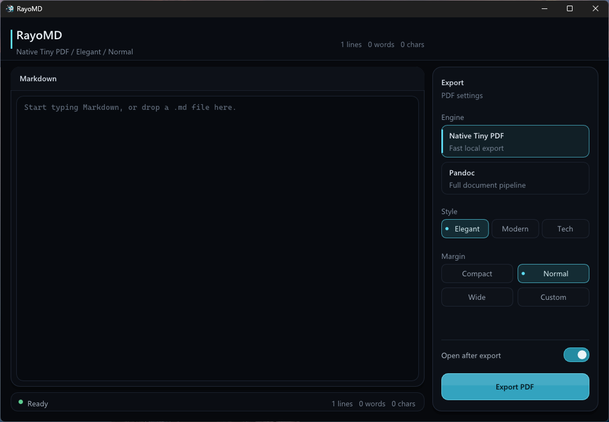
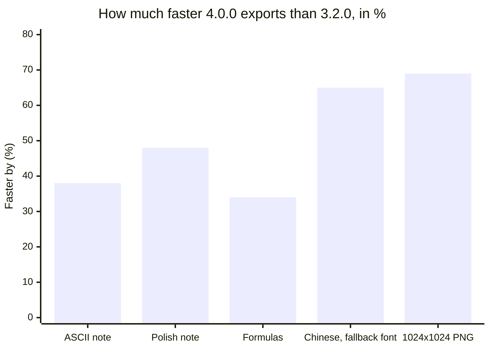
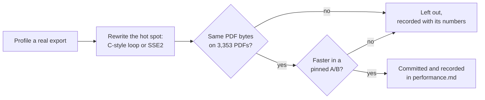

<a id="readme-top"></a>

<div align="center">


# RayoMD

**Markdown to PDF in milliseconds, from a single small executable.**<br>
No browser. No LaTeX. No Pandoc. No runtime.

<a href="https://github.com/Butterski/rayomd/releases/latest"></a>
<a href="https://github.com/Butterski/rayomd/releases"></a>
<a href="LICENSE"></a>

<a href="https://github.com/Butterski/rayomd/actions/workflows/ci.yml"></a>
<a href="https://github.com/Butterski/rayomd/actions/workflows/hygiene.yml"></a>
<a href="https://github.com/Butterski/rayomd/actions/workflows/release.yml"></a>
<a href="https://github.com/Butterski/rayomd/actions/workflows/codeql.yml"></a>


<a href="https://github.com/Butterski/rayomd/stargazers"></a>

[**Download**](https://github.com/Butterski/rayomd/releases/latest) ·
[Quick start](#quick-start) ·
[Features](#features) ·
[Benchmarks](#performance) ·
[Documentation](https://github.com/Butterski/rayomd/wiki)



<sub><a href="docs/assets/demo/show.gif">Watch the demo (GIF)</a> · <a href="docs/assets/demo/show.mp4">MP4</a></sub>

</div>

> [!TIP]
> **New in 4.0:** one-shot exports run **34 to 69 % faster** than 3.2.0, warm exports 16 %,
> with byte-identical PDFs, and Linux gets a **fully static edition** with no runtime
> dependency at all. See [the numbers](#performance).

RayoMD parses Markdown and writes PDF bytes directly, in its own C++17 code. Windows gets a
compact Dear ImGui app with command-line modes, Linux a small CLI, and both share one exporter
you can also embed through the [C++ API](https://github.com/Butterski/rayomd/wiki/C++-API).

## Highlights

<table>
<tr>
<td width="33%" valign="top">

### Fast
A short note in about **1 ms**, start to exit; a 1024×1024 PNG in 27 ms. Batches run on up
to 64 threads.

</td>
<td width="33%" valign="top">

### Small
A **604 KB** Linux download and a 1.4 MB Windows app. No browser engine, TeX stack or
runtime to install.

</td>
<td width="33%" valign="top">

### Math
A TeX subset **typeset natively**: fractions, roots, sums, matrices. No LaTeX, no embedded
math fonts.

</td>
</tr>
<tr>
<td valign="top">

### Code and images
Code coloured as on GitHub in **29 languages**; PNG, JPEG, and SVG drawn as vectors.

</td>
<td valign="top">

### Books and themes
One PDF from a `SUMMARY.md`, tables of contents, company fonts, colours, headers and a
cover.

</td>
<td valign="top">

### Standards
Tagged **PDF/UA-1** for screen readers and **PDF/A-3b** for archives, validated with
veraPDF.

</td>
</tr>
</table>

## Quick start

<details open>
<summary><b>Linux</b>: download and run</summary>

```sh
curl -LO https://github.com/Butterski/rayomd/releases/download/v4.0.0/rayomd-4.0.0-linux-x64-static.tar.gz
tar -xzf rayomd-4.0.0-linux-x64-static.tar.gz
./rayomd-4.0.0-linux-x64-static/rayomd --export input.md output.pdf
```

</details>

<details>
<summary><b>Windows</b>: the app and the CLI in one <code>rayomd.exe</code></summary>

Download `rayomd-4.0.0-windows-x64.zip` from
[Releases](https://github.com/Butterski/rayomd/releases/latest) and unpack it. `rayomd.exe`
without arguments opens the app: edit or drop a file, pick a style and margins, and press
`Ctrl+E` to export. With arguments it is the same CLI as on Linux:

```sh
rayomd.exe --export input.md output.pdf
```

</details>

<details>
<summary><b>Build from source</b></summary>

A C++17 compiler and CMake; on Linux also `zlib1g-dev` and a TrueType font such as
`fonts-dejavu-core`. On Windows add `-G "MinGW Makefiles"`.

```sh
cmake -S . -B build -DCMAKE_BUILD_TYPE=Release
cmake --build build --config Release
./build/rayomd --doctor
./build/rayomd --export input.md output.pdf
```

</details>

| Package | For |
|---|---|
| `rayomd-<version>-windows-x64.zip` | Windows: the app and every CLI mode in one `rayomd.exe` |
| `rayomd-<version>-linux-x64.tar.gz` | Linux: needs only glibc and zlib |
| `rayomd-<version>-linux-x64-static.tar.gz` | Linux with no dependency at all, the fastest start |
| `rayomd-<version>-linux-x64-curl.tar.gz` | Linux with HTTP/HTTPS images through libcurl |

Every feature below works the same from both command lines and the
[C++ API](https://github.com/Butterski/rayomd/wiki/C++-API).

## Performance

4.0.0 against 3.2.0, measured on 2026-10-12: Linux x86-64, g++ 13.3, files on tmpfs, one
pinned CPU core. A one-shot export is a fresh `rayomd --export` process, start to exit (median
of 60 runs).



| Document | 3.2.0 | 4.0.0 | Faster by |
|---|---:|---:|---:|
| Short note, ASCII | 1.69 ms | **1.04 ms** | 38 % |
| Short note, Polish text | 2.53 ms | **1.31 ms** | 48 % |
| Mixed document with formulas (`single_01.md`) | 6.27 ms | **4.14 ms** | 34 % |
| Short Chinese note, drawn in a fallback font | 7.59 ms | **2.67 ms** | 65 % |
| One 1024×1024 RGBA PNG | 87.56 ms | **27.26 ms** | 69 % |

Warm exports, repeated in one process with `--bench`, run 16 % faster (geometric mean of the
nine watch-suite documents, pinned; documents with formulas up to 25 %). Every change kept the
PDFs byte for byte those of 3.2.0, checked on a corpus of 3,353 PDFs. The fully static Linux
edition starts another 0.3 ms sooner: a short ASCII note in 0.68 ms.

| Release asset | Size |
|---|---:|
| `rayomd-4.0.0-linux-x64.tar.gz` | 604 KB |
| `rayomd-4.0.0-linux-x64-static.tar.gz` | 1,039 KB |
| `rayomd-4.0.0-windows-x64.zip` (GUI and CLI) | 1,444 KB |

[`performance.md`](docs/development/performance.md) records how every number was taken and what
each change gained; the warm comparisons come from `python3 tools/benchmark.py ab`. The
[benchmark index](https://github.com/Butterski/rayomd/wiki/Benchmarks) keeps older reports,
comparisons with other tools, and their caveats.

## The 4.0 goal: hot code in faster forms

RayoMD 4.0 moves the code where the time goes into lower-level, faster forms, one measured
change at a time, and the 4.x releases continue it: plain C-style loops over raw buffers where
library containers allocated and copied, SSE2 SIMD instructions where one operation can work on
sixteen bytes, and a statically linked runtime where process start dominated.



- **Images.** PNGs are decoded and re-encoded one row at a time: no whole-image buffers, filter
  scoring and unfiltering in SSE2, zlib checksums with RayoMD's SSE2 Adler-32.
- **Text.** Numbers and glyph codes are written from digit-pair tables, a character's width is
  one table lookup, and text with formulas no longer copies every word.
- **Start-up.** No iostreams, the C++ runtime linked in, fonts memory-mapped instead of read,
  and a fully static Linux edition.

What is left in the profiles, and what was tried and rejected, is listed under *Measured
opportunities* in [`performance.md`](docs/development/performance.md).

<p align="right"><a href="#readme-top">back to top ↑</a></p>

## Features

### Markdown

GitHub-flavoured Markdown as people write it. Headings become PDF bookmarks and `#anchor`
targets, and a table's header row repeats on every page it reaches:

```markdown
# Report

Text with **bold**, *italic*, ~~strike~~, `code` and a [link](https://example.com).
A bare URL like https://example.com and an address like team@example.com are clickable.

- [x] Task lists
- Nested bullet and numbered lists
  1. like this one

> [!WARNING]
> GitHub alerts: NOTE, TIP, IMPORTANT, WARNING and CAUTION.

| Item | Price |
|:-----|------:|
| Tea  |  2.50 |

A sentence with a footnote.[^1]

[^1]: Set after the text, linked both ways.
```

Also reference links (full, collapsed and shortcut), `<…>` autolinks, rules, page breaks
(`\pagebreak`, `\newpage`, `<!-- pagebreak -->`), `<br>`, character references such as
`&copy;`, and hidden HTML comments. Unicode text uses an embedded subset of a system font (or
the one `RAYOMD_FONT` names) with fallback fonts for other scripts; Latin text stays on the PDF
standard fonts, which keeps those files small.

### Code highlighting

Fenced code in one of 29 languages is coloured as GitHub's light theme colours it: shell,
console, PowerShell, batch, JavaScript, TypeScript, Python, C, C++, C#, Java, Kotlin, Go, Rust,
Swift, PHP, Ruby, SQL, HTML, XML, CSS, SCSS, JSON, YAML, TOML, INI, Dockerfile and diff.
`--no-highlight` draws every block in one colour.

````markdown
```python
def greet(name):
    return f"Hello, {name}"
```
````

### Math

A TeX subset typeset natively, with no LaTeX and no embedded math fonts, in text, lists, quotes,
headings and table cells. Unknown or malformed input degrades to readable output; see
[`native_math.md`](docs/development/native_math.md).

```markdown
The roots are $x = \frac{-b \pm \sqrt{b^2 - 4ac}}{2a}$.

$$
\sum_{i=1}^{n} i = \frac{n(n+1)}{2}
$$
```

### Images

```markdown


```

- PNG and JPEG, sized to the page; a missing or unreadable image shows its alt text, and an
  image inside a paragraph reads `image: alt`.
- SVG drawn as vectors by RayoMD's own converter: paths, shapes, transforms, clipping, linear
  gradients, opacity, text in the document's font, embedded PNG/JPEG, and Illustrator style
  sheets. Charts from matplotlib, Vega-Lite, Plotly and Graphviz draw close to a browser; an SVG
  that needs scripts or HTML (Mermaid) shows its alt text.
- Local images must lie in the input file's folder unless `--allow-unsafe-local-images`;
  HTTP/HTTPS images load only with `--allow-url-images` (Windows, and the curl Linux build).

### Page layout

Styles `elegant` (default), `modern` and `tech`; margins `compact`, `normal`, `wide`,
`margin=0.75in` or `margin=54pt`; page sizes `a4` (default), `a3`, `a5`, `letter`, `legal`,
each also `-landscape`, or any `WIDTHxHEIGHT` in `mm`, `cm`, `in` or `pt`; "N / M" page
numbers.

```sh
rayomd --export report.md report.pdf modern wide --page-size=letter-landscape --page-numbers
```

### Document metadata

The YAML front matter fills the PDF's metadata and is not shown on the page. Without a `title`
the first heading is the title; `description` stands in for `subject`.

```yaml
---
title: Quarterly report
author: [Ann Smith, Bob Lee]
subject: Sales in Q3
keywords: [sales, q3]
lang: en-GB
---
```

### Tables of contents

A paragraph `[TOC]` or `[[_TOC_]]` becomes a table of contents with dot leaders, page numbers
and links to the headings; `--toc` puts one first, and `--toc-depth=N` (1 to 6, default 3) sets
how many heading levels it lists.

```sh
rayomd --export handbook.md handbook.pdf --toc --toc-depth=2
```

### Themes

`--theme=FILE` lays a company look over a style: your TrueType font, heading, link and accent
colours, a header and footer with placeholders (`{title}`, `{author}`, `{subject}`, `{date}`,
`{page}`, `{pages}`, `{logo}`) and a logo, and a cover page. Paths are relative to the theme
file; see [Themes](https://github.com/Butterski/rayomd/wiki/Themes).

<details>
<summary>Example theme file</summary>

```ini
font = fonts/AcmeSans.ttf
heading-color = #0B3D91
link-color = #0B6E4F
accent-color = #F2A900
header-left = {logo}
header-right = {title}
footer-left = {author}
footer-right = {date}
logo = acme-logo.svg
cover = yes
```

</details>

### Books

`--book` makes one PDF of several files: those a `SUMMARY.md` lists (mdBook and GitBook, with
parts and nesting), a folder's files by name with `README.md` first, or the files given. Each
starts on a new page, links between them (`other.md#heading`) stay links inside the PDF, the
bookmarks nest by part, and `--toc` gives one table of contents for the whole book.

```sh
rayomd --book docs/src/SUMMARY.md manual.pdf --toc --page-numbers
```

### Batch conversion

`--batch` converts a folder on up to 64 threads (6 by default); `--recursive` mirrors its
subfolders, `--skip-unchanged` keeps PDFs newer than their Markdown, and `--report` writes one
JSON line per document (`-` for standard output). `--stdin` converts Markdown piped in,
`--stdin-batch` converts the paths piped in, and `--serve` stays running and converts each path
it reads, answering one line per document.

```sh
rayomd --batch docs pdf-out --recursive --skip-unchanged --report=report.jsonl --workers=8
cat notes.md | rayomd --stdin notes.pdf
```

### Compression, archiving and accessibility

- `--compress` writes page content, fonts and CMaps as FlateDecode streams with RayoMD's own
  DEFLATE encoder: text-heavy PDFs come out two to five times smaller.
- `--pdfa` writes PDF/A-3b for archiving: every font embedded, an sRGB output intent, XMP
  metadata and a file identifier.
- `--pdfua` writes tagged PDF/UA-1 for screen readers: headings, lists, tables with header
  scope, figures with their alt text, formulas, links and footnotes in reading order, decoration
  marked as artifacts; the language is the front matter's `lang`, else `en`.

PDF/A and PDF/UA need a TrueType font to embed and show formulas as their TeX source; together
the file claims both, and every test document passes veraPDF. See
[Archival and Accessible PDFs](https://github.com/Butterski/rayomd/wiki/Archival-and-Accessible-PDFs).

```sh
rayomd --export policy.md policy.pdf --pdfa --pdfua --compress
```

### Reversible PDFs

`--embed-source` attaches the exact Markdown to the PDF and `--recover-source` gets it back byte
for byte; `--inspect-source` describes it.

> [!IMPORTANT]
> Embedding is off by default: the file then carries the whole source, including anything not
> shown on the pages. See [Reversible PDFs](https://github.com/Butterski/rayomd/wiki/Reversible-PDFs).

```sh
rayomd --export notes.md notes.pdf --embed-source
rayomd --recover-source notes.pdf recovered.md
```

### Diagnostics and Pandoc mode

`--doctor` checks fonts, temporary output and a smoke export; `--bench` times repeated exports of
one document; `--version` prints the version. Exit codes are in the
[CLI Reference](https://github.com/Butterski/rayomd/wiki/CLI-Reference). On Windows an optional
Pandoc mode hands documents to an installed Pandoc when the native subset is not enough.

```sh
rayomd --doctor
rayomd --bench report.md bench-out 200 modern normal
```

<p align="right"><a href="#readme-top">back to top ↑</a></p>

## Boundaries

> [!NOTE]
> RayoMD's renderer is a fast Markdown subset, not a Pandoc clone. When you need the things
> below, use Pandoc, LaTeX or a browser renderer.

It does not promise full CommonMark/Pandoc compatibility, complete LaTeX math (packages,
macros, automatic numbering), highlighting for every language, citations, filters, templates,
right-to-left scripts (Arabic and Hebrew are drawn left to right, unshaped), complete SVG
(radial gradients and patterns are approximated; markers, filters and masks are not drawn), or
HTML/CSS layout. Under `--pdfua` a theme's cover page is tagged as decoration and an inline
formula is text showing its TeX source. Missing or unsupported images and malformed math degrade
to readable fallbacks instead of failing the export. The complete matrix is in
[Native Markdown Support](https://github.com/Butterski/rayomd/wiki/Native-Markdown-Support).

## Documentation

| Topic | Guide |
|---|---|
| Installation and builds | [Getting Started](https://github.com/Butterski/rayomd/wiki/Getting-Started) |
| Commands, flags and exit codes | [CLI Reference](https://github.com/Butterski/rayomd/wiki/CLI-Reference) |
| Folders, reports, incremental runs | [Batch Conversion](https://github.com/Butterski/rayomd/wiki/Batch-Conversion) |
| One PDF of many files | [Books](https://github.com/Butterski/rayomd/wiki/Books) |
| Fonts, colours, headers, cover pages | [Themes](https://github.com/Butterski/rayomd/wiki/Themes) |
| PDF/A-3b and PDF/UA-1 | [Archival and Accessible PDFs](https://github.com/Butterski/rayomd/wiki/Archival-and-Accessible-PDFs) |
| Supported Markdown subset | [Native Markdown Support](https://github.com/Butterski/rayomd/wiki/Native-Markdown-Support) |
| Exact source recovery and privacy | [Reversible PDFs](https://github.com/Butterski/rayomd/wiki/Reversible-PDFs) |
| Embedding the exporter | [C++ API](https://github.com/Butterski/rayomd/wiki/C++-API) |
| Release assets and dependencies | [Packaging and Releases](https://github.com/Butterski/rayomd/wiki/Packaging-and-Releases) |
| Benchmarks and caveats | [Benchmarks](https://github.com/Butterski/rayomd/wiki/Benchmarks) |
| Regression measurement | [Performance Watcher](https://github.com/Butterski/rayomd/wiki/Performance-Watcher) |

Engineering contracts stay beside the code:
[`performance.md`](docs/development/performance.md),
[`native_math.md`](docs/development/native_math.md),
[`reversible_pdf_profile.md`](docs/development/reversible_pdf_profile.md) and
[`arbitrary_pdf_research_decision.md`](docs/development/arbitrary_pdf_research_decision.md).

## Contributing

Read [`AGENTS.md`](AGENTS.md) and [`CONTRIBUTING.md`](CONTRIBUTING.md) first. A change to hot
code comes with before/after measurements and byte-identical output unless changing the output
is its purpose; benchmark claims stay dated and scoped; builds, PDFs and corpora stay out of
the repository. Pandoc is never bundled into the lightweight packages.

<a href="https://github.com/Butterski/rayomd/graphs/contributors">
  
</a>

## Star history

<a href="https://star-history.com/#Butterski/rayomd&Date">
  
</a>

## License

RayoMD is released under the Apache License 2.0; see [`LICENSE`](LICENSE). [`NOTICE`](NOTICE)
lists the third-party code and the runtime libraries linked into the release binaries. Dear
ImGui keeps its own license in [`third_party/imgui/LICENSE.txt`](third_party/imgui/LICENSE.txt).

<p align="right"><a href="#readme-top">back to top ↑</a></p>
